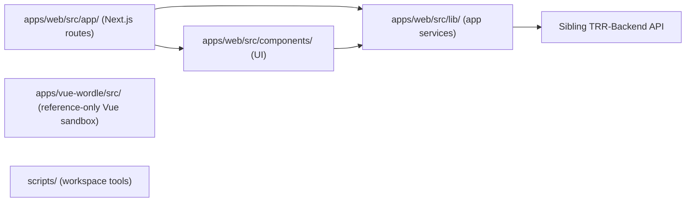
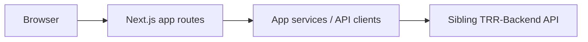

# System Architecture Maps

<!-- Generated from scripts/generate_repo_mermaid.py; edit the template, not this output. -->

## Module Boundaries

## Request Flow

## Key Components

- **apps/web/src/app/**: Next.js pages and API routes
- **apps/web/src/components/**: Shared app and admin UI
- **apps/web/src/lib/**: App-side services and API clients
- **apps/vue-wordle/src/**: Reference-only Vue Wordle sandbox; lifecycle and installation boundary: [README](../../../apps/vue-wordle/README.md)
- **scripts/**: Workspace tooling
